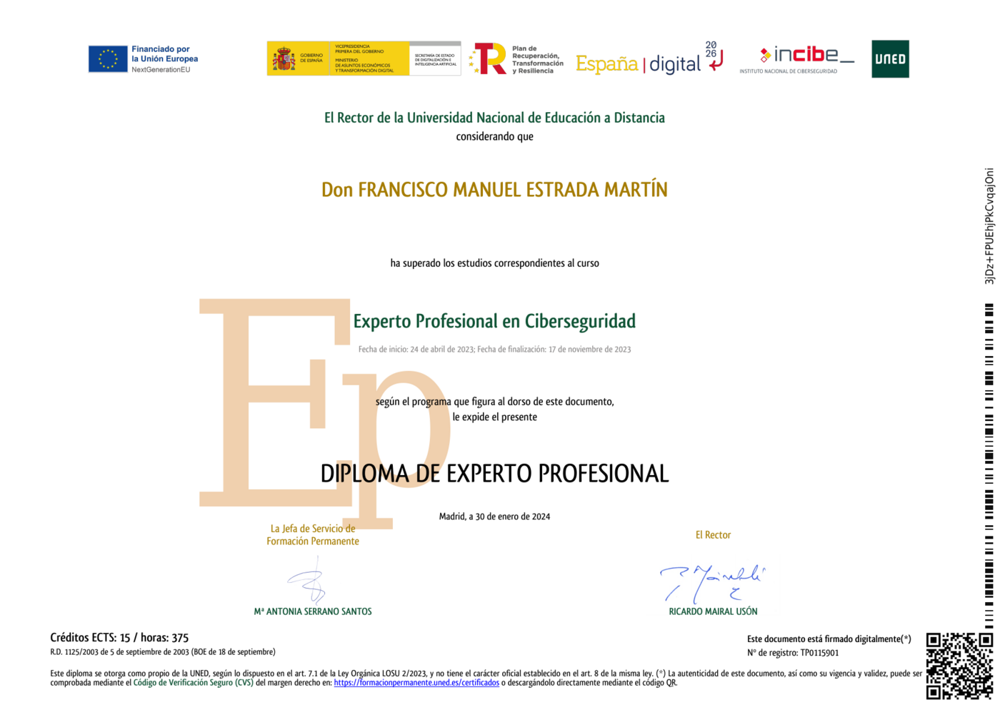
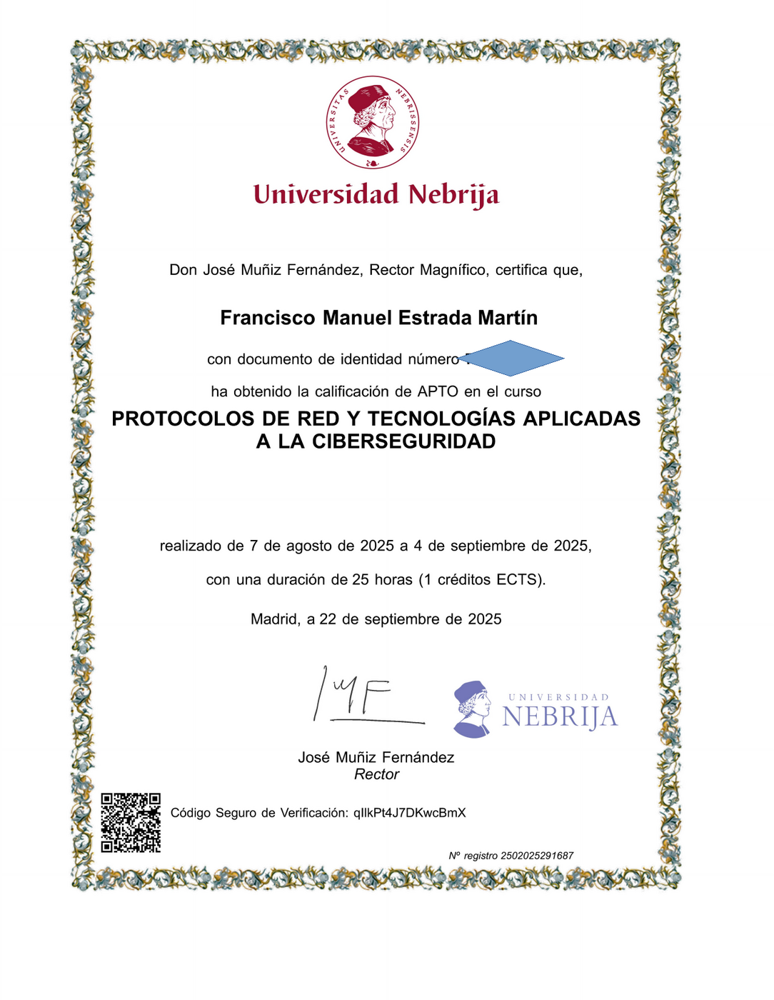
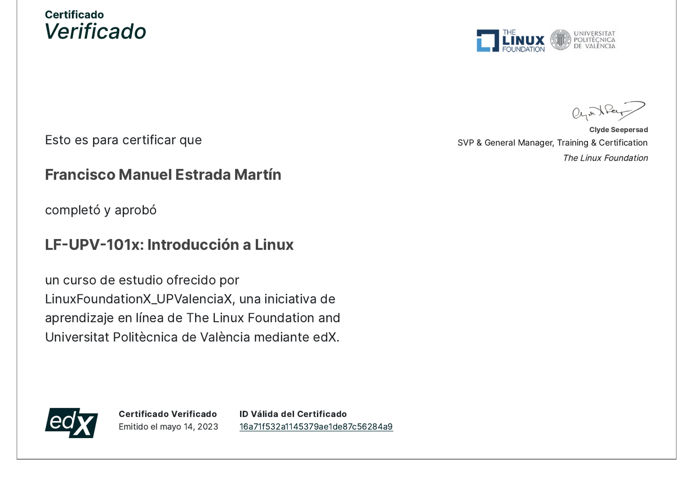
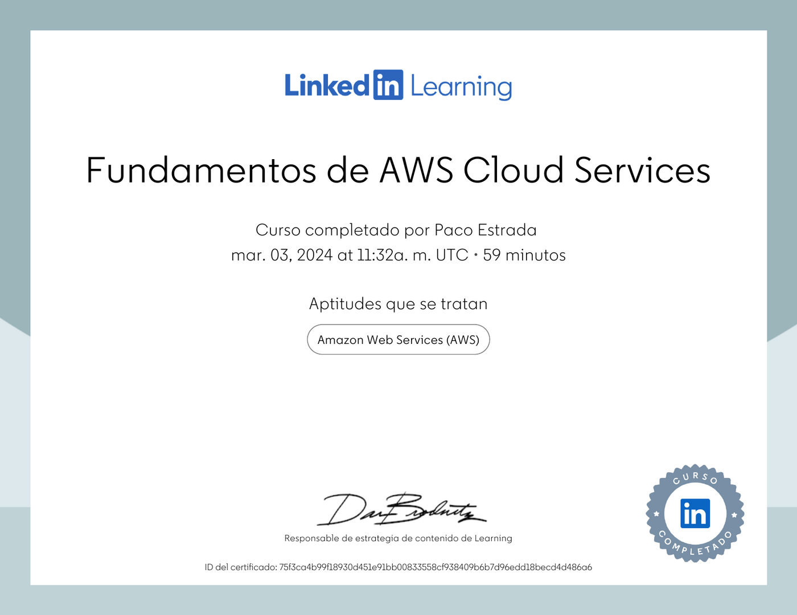
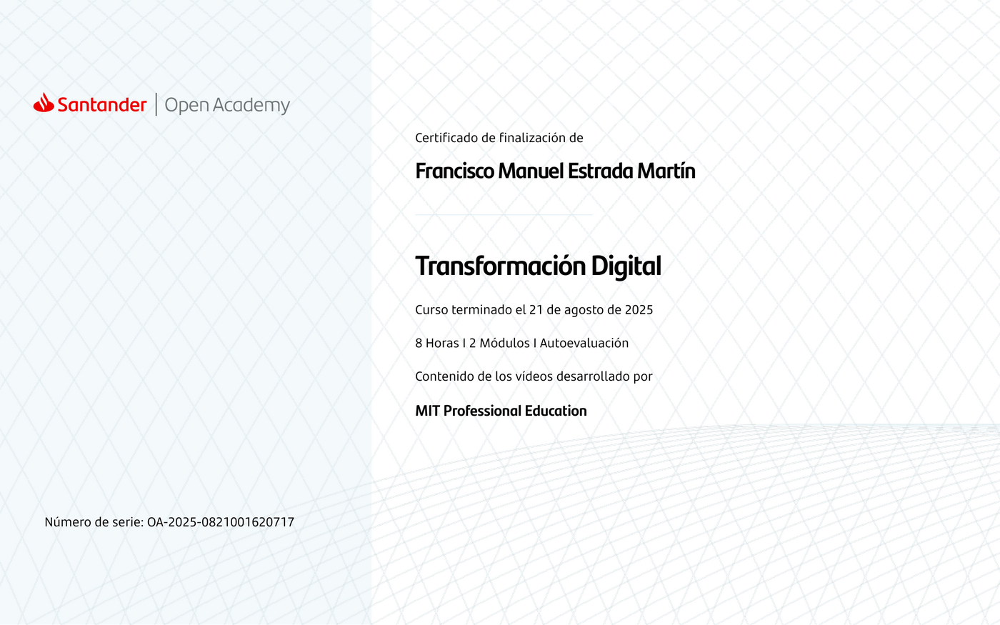
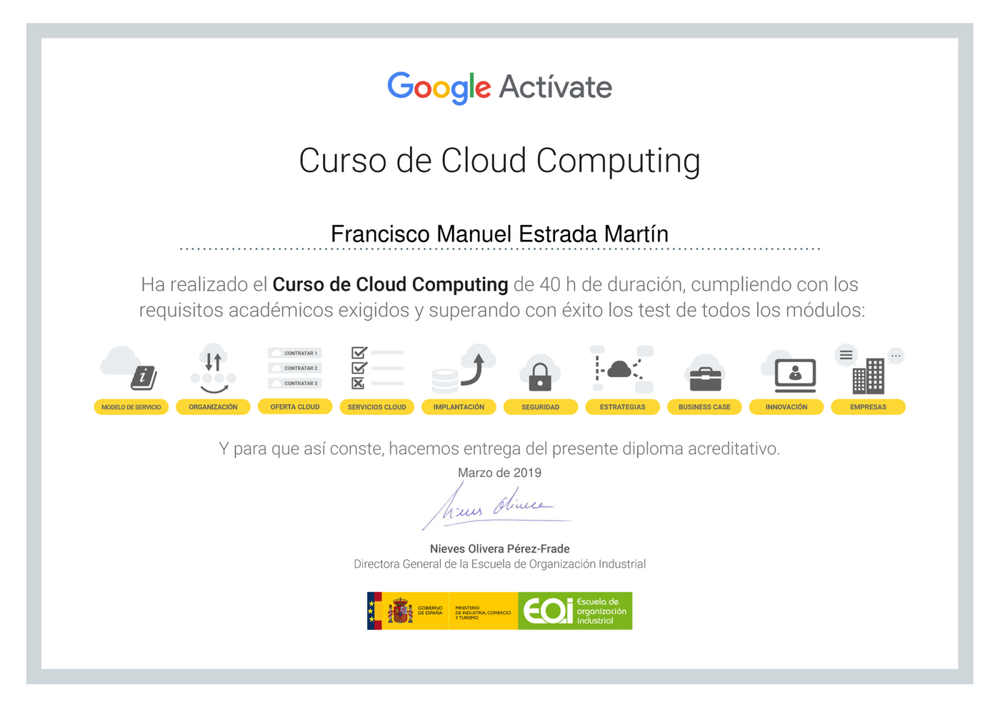
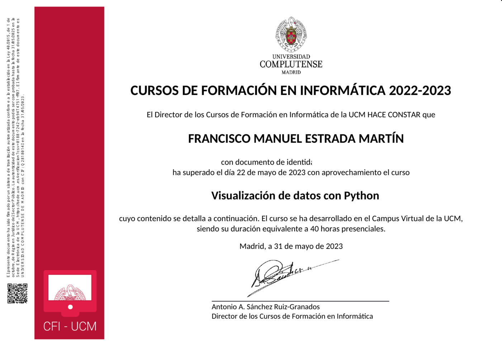

# Hola, soy Paco Estrada 👋

### Comunicación, audio, software libre y tecnología aplicada

**Herramientas actuales**

📸 [CapturFácil](https://github.com/pacoestrada/capturfacil) · Capturas y anotaciones para GNOME

🎙️ [Atril Teleprónter](https://github.com/pacoestrada/atril-teleprompter) · 🎬 [Conversor de medios](https://github.com/pacoestrada/conversor-medios-davinci-linux)  
📰 **Editor de noticias** (proyecto privado) · ✨ [Títulos y efectos para DaVinci](https://github.com/pacoestrada/dentro-del-texto-fusion)

Cuento con más de 35 años de experiencia en producción sonora y locución. Actualmente aplico esa trayectoria al lugar donde se cruzan la comunicación, la divulgación tecnológica y el software libre.

Produzco contenidos para radio y pódcast, colaboro con comunidades y eventos FLOSS y desarrollo pequeñas herramientas para resolver necesidades reales, especialmente en GNU/Linux.

## Proyectos destacados

Herramientas que nacen de mi trabajo en comunicación, producción audiovisual y publicación web.

<table>
<tr>
<td colspan="2" valign="top">
<h3>📸 CapturFácil</h3>

Captura una pantalla, una ventana o un área, añade flechas, texto y formas ajustables y guarda en PNG. Integración con Impr Pant, aparición en Recientes y opción de volver al capturador de GNOME.

<strong>Versión 1.1.0 · GNOME sobre X11 · DEB · Python / GTK 3</strong>

<a href="https://github.com/pacoestrada/capturfacil">GitHub</a> · <a href="https://gitlab.com/PacoEstrada/capturfacil">GitLab</a> · <a href="https://github.com/pacoestrada/capturfacil/releases/latest">Descargar</a>

</td>
</tr>
<tr>
<td width="50%" valign="top">
<h3>🎙️ Atril Teleprónter</h3>

Teleprónter de escritorio para Linux, pensado para vídeos, locuciones y pódcast. Importa guiones ODT, DOCX y TXT y permite leer y grabar la voz en la misma aplicación, con exportación a WAV, FLAC y MP3.

<strong>Grabación de voz · DEB, RPM y Arch · Python / PyQt5</strong>

<a href="https://github.com/pacoestrada/atril-teleprompter">GitHub</a> · <a href="https://gitlab.com/PacoEstrada/atril-teleprompter">GitLab</a> · <a href="https://github.com/pacoestrada/atril-teleprompter/releases/latest">Descargar</a>

</td>
<td width="50%" valign="top">
<h3>🎬 Conversor de medios</h3>

Prepara vídeos para editar en DaVinci Resolve y para publicar. Convierte MP4 a MOV con audio PCM, o MOV compatible a MP4 con AAC, conservando el vídeo sin recodificar y verificando el resultado.

<strong>Linux · DEB y RPM · FFmpeg / Bash / Python</strong>

<a href="https://github.com/pacoestrada/conversor-medios-davinci-linux">GitHub</a> · <a href="https://gitlab.com/PacoEstrada/conversor-medios-davinci-linux">GitLab</a> · <a href="https://github.com/pacoestrada/conversor-medios-davinci-linux/releases/latest">Descargar</a>

</td>
</tr>
<tr>
<td width="50%" valign="top">
<h3>📰 Editor de noticias</h3>

Herramienta de uso profesional para mantener una web estática. Reúne edición visual, imágenes, borradores, previsualización, publicación asistida y copias de seguridad.

<strong>Proyecto privado · Linux · Python</strong>

Presentado aquí como parte de mi trabajo en comunicación y automatización. El código y los materiales internos no son públicos.

</td>
<td width="50%" valign="top">
<h3>✨ Títulos y efectos para DaVinci Resolve</h3>

Recursos Fusion reutilizables, con controles editables y paquetes instalables <code>.drfx</code>.

<strong>Anotaciones para DaVinci · Paco Estrada</strong> · 27 títulos y 3 efectos para señalar elementos, tapar datos y desenfocar zonas. <a href="https://github.com/pacoestrada/pacoestrada-anotaciones-davinci">Guía y catálogo</a> · <a href="https://raw.githubusercontent.com/pacoestrada/pacoestrada-anotaciones-davinci/main/Anotaciones_DaVinci_Paco_Estrada_1.1.0.drfx">Descargar v1.1.0 (.drfx)</a>

<strong>Dentro del texto</strong> · El vídeo aparece dentro de las letras y el texto crece hasta revelar la escena. <a href="https://github.com/pacoestrada/dentro-del-texto-fusion">GitHub</a> · <a href="https://gitlab.com/PacoEstrada/dentro-del-texto-fusion">GitLab</a>

<strong>Galactic Crawl</strong> · Texto en perspectiva y estrellas. <a href="https://github.com/pacoestrada/galactic-crawl-fusion-title">GitHub</a> · <a href="https://gitlab.com/PacoEstrada/galactic-crawl-fusion-title">GitLab</a>

<strong>70 TV</strong> · Título animado de estética televisiva de los setenta. <a href="https://github.com/pacoestrada/70-tv-fusion-title">GitHub</a>

</td>
</tr>
</table>

## Áreas de trabajo e interés

- Producción sonora, locución, radio y pódcast.
- Comunicación y divulgación tecnológica.
- GNU/Linux, software libre y cultura abierta.
- Automatización y utilidades con Bash, Python, Git y FFmpeg.
- Organización, presentación y moderación de eventos.
- Experimentación práctica con inteligencia artificial y prompting.

## Tecnologías

## Otros proyectos y aprendizaje

Ver proyectos anteriores, experimentación y materiales de comunidad

- [Compliance Pulse](https://github.com/pacoestrada/compliance-pulse) · Radar de cumplimiento para pymes en fase beta, con diagnóstico guiado y una [demo web](https://pacoestrada.github.io/compliance-pulse/).
- [Herramienta de Prompting](https://github.com/pacoestrada/HerramientaDePrompting) · Experimentación con la creación y organización de instrucciones para herramientas de inteligencia artificial.
- [OpenSouthCode 2023](https://github.com/pacoestrada/OSC2023) · Materiales de entrevistas y scripts de análisis para el encuentro de Málaga.

## Formación tecnológica

Ver formación y acreditaciones

Mi formación combina programas universitarios, cursos profesionales y credenciales especializadas en ciberseguridad, redes, GNU/Linux, computación en la nube, transformación digital, software abierto y análisis de datos con Python.

Pulsa sobre cualquier diploma para abrirlo a mayor tamaño.

### Ciberseguridad y redes

<table>
  <tr>
    <td width="50%" align="center" valign="top">
       
      <strong>Experto Profesional en Ciberseguridad</strong> 
      UNED · 15 ECTS / 375 horas · 2023
    </td>
    <td width="50%" align="center" valign="top">
       
      <strong>Protocolos de red y tecnologías aplicadas a la ciberseguridad</strong> 
      Universidad Nebrija · 25 horas / 1 ECTS · 2025
    </td>
  </tr>
</table>

### GNU/Linux y servicios en la nube

<table>
  <tr>
    <td width="50%" align="center" valign="top">
       
      <strong>LF-UPV-101x: Introducción a Linux</strong> 
      The Linux Foundation y Universitat Politècnica de València · edX · 2023
    </td>
    <td width="50%" align="center" valign="top">
       
      <strong>Fundamentos de AWS Cloud Services</strong> 
      LinkedIn Learning · 2024
    </td>
  </tr>
</table>

### Transformación digital, cloud y datos

<table>
  <tr>
    <td width="50%" align="center" valign="top">
       
      <strong>Transformación Digital</strong> 
      Santander Open Academy · Contenidos de MIT Professional Education · 2025
    </td>
    <td width="50%" align="center" valign="top">
       
      <strong>Curso de Cloud Computing</strong> 
      Google Actívate y EOI · 40 horas · 2019
    </td>
  </tr>
  <tr>
    <td colspan="2" align="center" valign="top">
       
      <strong>Visualización de datos con Python</strong> 
      Universidad Complutense de Madrid · 40 horas · 2023
    </td>
  </tr>
</table>

### Credenciales IBM

<table>
  <tr>
    <td width="50%" align="center" valign="top">
       
      <strong>Python for Data Science</strong> 
      IBM
    </td>
    <td width="50%" align="center" valign="top">
       
      <strong>Open Source Foundations</strong> 
      IBM
    </td>
  </tr>
</table>

## Comunicación y comunidad

Produzco [Compilando Podcast](https://compilando.es), un espacio dedicado a GNU/Linux, el software libre y la cultura abierta.

También he participado en iniciativas y eventos tecnológicos como OpenSouthCode y OpenExpo Europe, colaborando en tareas de organización, comunicación, presentación y moderación.

## Contacto

- [Compilando Podcast](https://compilando.es)
- [LinkedIn](https://www.linkedin.com/in/pacoestrada/)
- [MyPublicInbox](https://www.mypublicinbox.com/PacoEstrada)

